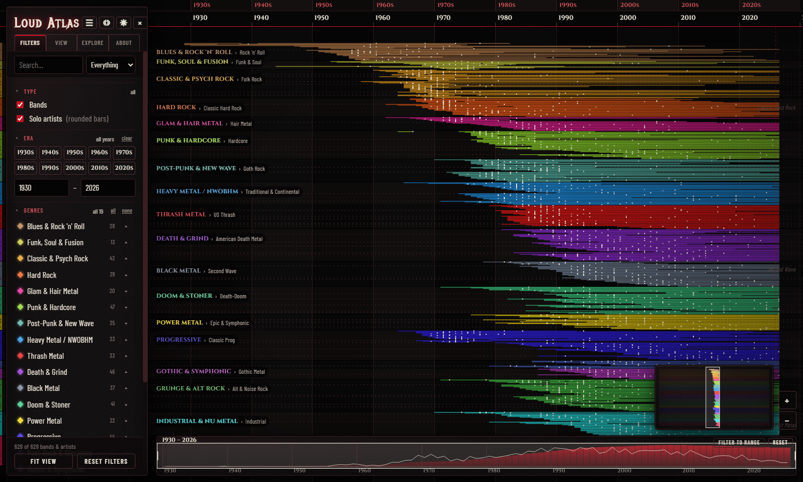
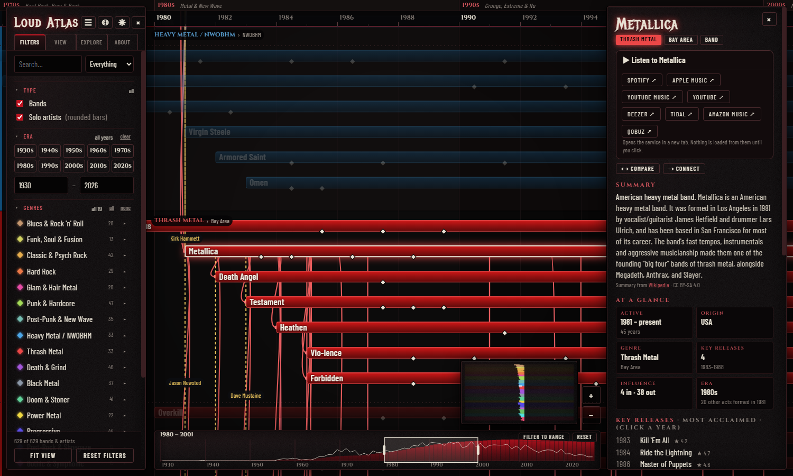
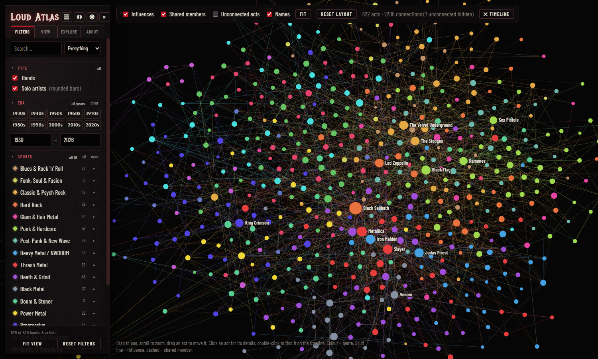
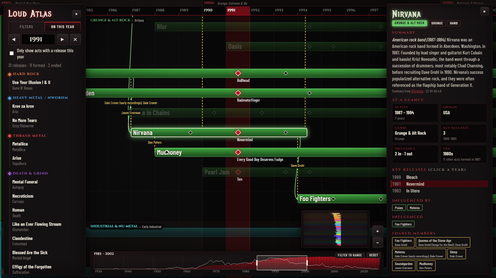
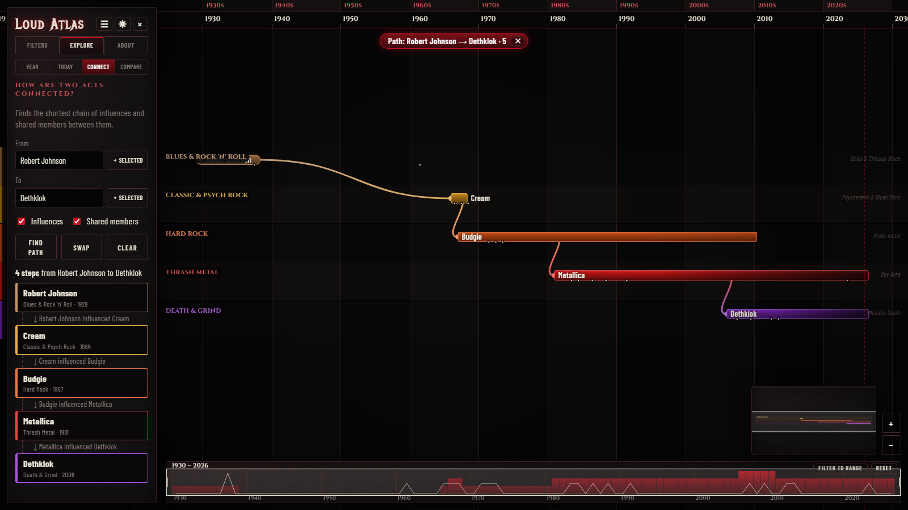
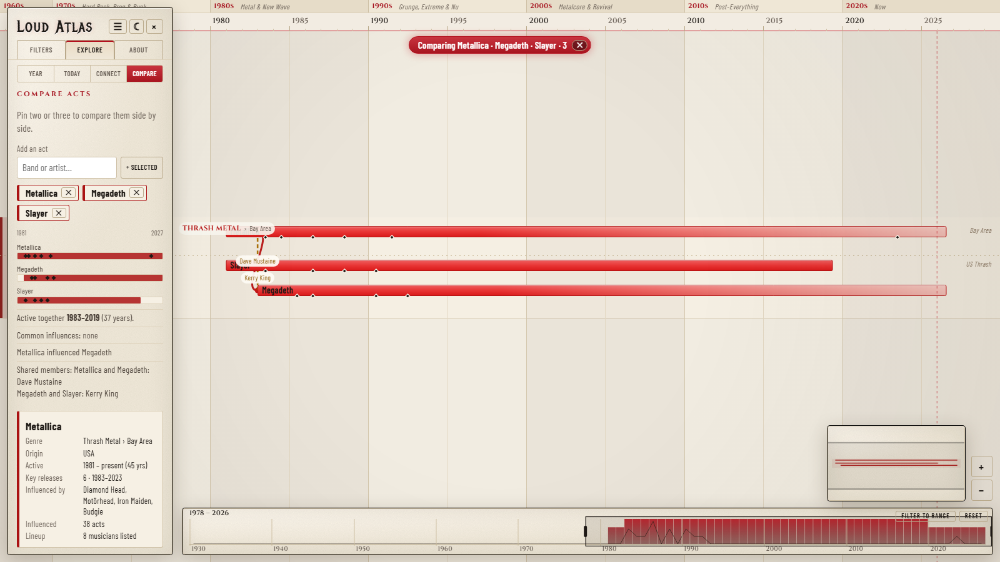

# Loud Atlas

**[Live site: loud-atlas.pages.dev](https://loud-atlas.pages.dev)**

**An interactive map of rock and metal history.** Pan and zoom across a timeline from the 1930s blues to today,
and see how bands and solo artists, their key releases, genres and subgenres, influences and shared members
connect.



- **629 bands and solo artists** in 19 genre lanes and 76 subgenres, from Delta blues and rock 'n' roll through
  punk, post-punk, thrash, death, black and doom metal to post-rock and modern metalcore, with scenes from 30 countries
- **Influence lines** showing who shaped whom, and **shared-member lines** (dashed) for musicians who moved between bands
- **2,277 key releases** chosen by rule (most acclaimed or most listened), with an option to show every studio and live album
- No build step, no framework, no server: it is a static page drawn on an HTML canvas





## Features

| | |
|---|---|
| **Open canvas** | Drag to pan, scroll to zoom, Shift+scroll to zoom time only. Pinch works on touch screens. |
| **Band details** | Click a band for a Wikipedia summary, an at-a-glance fact grid, key releases, influences, shared members and lineup. |
| **Releases** | Show the curated **key releases**, or switch to **all albums** (full studio discography from MusicBrainz), and optionally add **live albums**. The marker shows the type: a solid bone diamond is a key release, a hollow diamond another studio album, an amber circle a live album. |
| **Click-to-filter details** | In a band's details, click its genre or subgenre tag to show only that genre or subgenre. Each of "Influenced by", "Influenced" and "Shared members" has a **filter** button that shows only that lineage (roots, offspring or member-sharing bands), and clicking a musician's name shows every band they played in. Active filters appear as removable pills at the top of the map. |
| **Connect** | Pick two acts and see the shortest chain of influences and shared members between them, for example Robert Johnson → Cream → Budgie → Metallica → Dethklok. The chain is drawn on the map and listed step by step. |
| **Compare** | Pin two or three acts: a shared timeline, years active together, common influences, direct influence, shared members, and a card for each. |
| **On this day** | Every album on the map released on a chosen day of the year, with how many years ago it came out. |
| **Themes** | Dark and light, following your system setting until you choose. The choice is remembered. |
| **Accessibility** | A text list of every act (press `L`, or use the skip link), keyboard navigation of the map and the time strip, screen-reader announcements, visible focus, and reduced-motion support. |
| **On this year** | A tab that lists every key release, formation and breakup in a chosen year. The year is highlighted as a column on the timeline, and a switch hides every act without a release that year. |
| **Era filter** | Click a decade on the ruler, or use the decade chips, to filter to that era. |
| **Time brush** | A strip along the bottom shows how many acts were active each year. Drag its window to pan, drag the edges to zoom time, or drag empty space to pick a range. "Filter to range" turns the selection into a year filter. |
| **Search** | Search by band name, album or **member**. Typing a musician's name lists the bands they played in. |
| **Filters** | Collapsible sections with a summary of each; genre, bands vs solo artists, country, year range. Each genre in the list has an **arrow** that opens its subgenres: click one to show or hide it, Alt+click to show only that one. A half-filled marker means some of a genre's subgenres are hidden. |
| **Subgenre lanes** | Each genre lane splits into subgenre groups (for example Bay Area, Teutonic and Brazilian thrash). |
| **About tab** | Explains the map, links to this repository and the issue tracker, and lists the data sources. |
| **Relationship graph** | Press `G`: the acts that match your filters as a network, coloured by genre, with influences and shared members as lines. Drag, zoom, click an act for its details, double-click to find it on the timeline. |
| **Two ways to pick key releases** | In the **View** tab choose the most acclaimed albums (community ratings) or the most listened (ListenBrainz). |
| **Listen** | A **Listen** menu in each act's details: links to its page on Spotify, Apple Music, YouTube, Bandcamp and others (from MusicBrainz), or a search link where none is stored. Nothing is embedded or loaded from those services until you click. |
| **Official links** | Each act's official site, social profiles and reference pages (from MusicBrainz) in its details. |
| **Search suggestions** | Typing lists matching acts, members and albums; Enter jumps to the act at a readable zoom. |
| **Minimap** | Click or drag to jump around the whole map. |







### Keyboard

| Key | Action |
|---|---|
| `Tab` to the map, then `J` / `K` | Next or previous act, then `Enter` for its details |
| Arrow keys, `+` / `-`, `0` | Pan, zoom, fit |
| `/` | Search |
| `G` | Relationship graph |
| `L` | List view (a text table of the acts that match your filters) |
| `T` | Switch theme |
| `Esc` | Clear the selection or close the list |
| Arrow keys, `+` / `-`, `Home` on the time strip | Move, zoom and reset the time range |

### Controls

| Action | Input |
|---|---|
| Pan | Drag, or arrow keys |
| Zoom | Scroll, `+` / `-`, or the on-screen buttons |
| Zoom time only | Shift+scroll, or the time brush |
| Fit everything | `0`, "Fit view", or double-click the time brush |
| Select a band | Click it. `Esc` clears the selection. |
| Pick a year | Click the lower row of the ruler, or click a release diamond |
| Filter to a decade | Click the upper row of the ruler |

### Shareable links

The page reads its state from the URL hash, so you can link to a view:

```
index.html#band=metallica&year=1986&zoom=1.6
index.html#q=hammett&scope=member
index.html#tab=year&year=1991
index.html#era=5,6
```

| Parameter | Meaning |
|---|---|
| `band` | Act id to select (see `data/acts.json`) |
| `year` | Year to highlight |
| `tab` | `filters` or `year` |
| `q`, `scope` | Search text, and `all`, `name`, `album` or `member` |
| `theme` | `light` or `dark` |
| `a`, `b`, `cmp`, `md`, `list` | With the Explore tab: `a=robertjohnson&b=dethklok` (a path), `cmp=metallica,megadeth` (a comparison), `md=05-07` (a day), `list=1` (list view) |
| `era` | Decade indices, comma-separated (`0` = 1930s, `9` = 2020s) |
| `focus`, `sub` | With `band`: `focus=roots`, `offspring` or `shared`, or `sub=Bay Area` |
| `expand` | Genres to open in the list, e.g. `expand=thrash,death`. `tab=about` opens the About tab. |
| `releases`, `live`, `criterion` | `releases=all` shows all albums, `live=1` adds live albums, `criterion=popular` picks the most-listened key releases |
| `zoom` | Zoom level when used with `band` |

## Run it

Open `index.html` in a browser. Nothing else is needed.

Fonts are bundled in `fonts/`, so the page makes no third-party requests and works offline.

## The data

The data is plain JSON in `data/`. That is the source of truth: readable, diff-friendly, one record per line, easy to open in a
spreadsheet (see CSV export below). `node tools/build-data.js` turns it into small JavaScript bundles (`data/bundle.*.js`) that
the page loads, so the site still opens straight from a file with no server.

| File | What it holds | How it is made |
|---|---|---|
| `data/acts.json` | Every band and solo artist: genre, subgenre, country, years, who influenced it, MusicBrainz id, and where the dates were verified | Hand-edited, then checked by `tools/verify.js` |
| `data/genres.json` | Genres (name, colour) and the order of their subgenres | Hand-edited |
| `data/shared.json` | Curated shared-member notes | Hand-edited |
| `data/musicbrainz.json` | Studio albums (first release date, community rating, vote count), official live albums, type and life span | `node tools/fetch-musicbrainz.js` |
| `data/members.json` | Lineups | `node tools/fetch-musicbrainz.js` |
| `data/links.json` | Official website, social profiles, listening pages (Spotify, Apple Music, Bandcamp, YouTube, ...), reference pages | `node tools/fetch-links.js` (MusicBrainz) |
| `data/summaries.json` | Short Wikipedia summaries | `node tools/fetch-summaries.js` |
| `data/popularity.json` | Listen counts and the top 10 songs per act (optional) | `node tools/fetch-popularity.js` with a ListenBrainz token |
| `data/release-checks.json` | Second-source release years | `node tools/verify-releases.js` |
| `data/export/*.csv` | Spreadsheet copies of the above | `node tools/export-csv.js` |

### How the key releases are chosen

Each act shows four **key releases**, and you choose the rule in the **View** tab:

- **Most acclaimed albums** (default): the studio albums with the best MusicBrainz community rating. Ratings are weighted
  by the number of votes, `score = (votes × rating + 3 × mean) / (votes + 3)`, so one 5-star vote cannot beat seventy votes
  averaging 4.6. An act with fewer than two rated albums also shows its debut, marked as unrated.
- **Most listened albums**: the albums with the most ListenBrainz listens. This needs `data/popularity.json` (see below); until
  it exists the option is disabled. Acts without listening data fall back to the acclaimed list and say so.

Both are rules applied to public data, not a list written from memory. They have biases of their own: community ratings favour
albums that many people bother to rate, and listen counts reflect ListenBrainz users, who are not everyone.

### Top songs

When `data/popularity.json` exists, an act's details show its ten most listened songs (versions such as live, demo, remix and
remaster are merged or dropped). To create it you need a free ListenBrainz account:

```
# https://listenbrainz.org/settings/  ->  "User token"
$env:LISTENBRAINZ_TOKEN = "your-token"      # PowerShell
node tools/fetch-popularity.js
node tools/build-data.js
```

The token is read from the environment only. It is never printed, cached, saved or sent to the browser.

### Accuracy

Dates are **checked against sources, not memory**. `node tools/verify.js` compares each act's start and end year with the
Wikipedia infobox ("years active"), Wikidata and MusicBrainz and records which sources agree in `acts.json` (`verified`,
`vsrc`). A group's start year follows the sources when they agree; a solo artist's career start means different things in
different sources, so those are left alone. `ended: null` means the act is still active. Where sources disagree the act is
flagged (`review`) and listed in `tools/verify-report.md`. Release years are cross-checked the same way by
`tools/verify-releases.js` (MusicBrainz against Wikidata, with the Wikipedia infobox as tie-breaker; two of three win), and the
disagreements are in `tools/release-report.md`.

What is still opinion: the genre and subgenre of an act, and the **influence lines**, are editorial judgement calls, not facts.
The "All albums" mode comes from MusicBrainz after simple cleaning (it drops demos, compilations, remasters and unofficial
recordings), so it can still include regional editions for 1960s acts whose UK and US albums differ. Corrections are very
welcome. See [Contributing](#contributing).

### Adding or editing an act

Each act is one line in `data/acts.json`:

```json
{"id":"metallica","name":"Metallica","kind":"band","genre":"thrash","sub":"Bay Area","country":"USA","formed":1981,"ended":null,"from":["diamondhead","motorhead","iron","budgie"],"mbid":"65f4f0c5-ef9e-490c-aee3-909e7ae6b2ab"}
```

- `ended` is `null` for active acts; `kind` is `band` or `artist` (solo artists are drawn with rounded ends).
- `from` lists the ids of the acts that influenced it. `sub` must be one of the subgenres in `genres.json`.
- To add acts from MusicBrainz: `node tools/add-act.js "Band Name"`, fix the genre and `from`, then fetch their data (see below).
- `node tools/match-mbids.js` proposes MusicBrainz ids for acts that have none or a doubtful match. Confirmed ones are marked
  `"mbMatch": "confirmed"`.

### Refreshing the data

Requires Node 18 or newer (for the built-in `fetch`). Each tool is throttled to respect the source's rate limits, caches every
response in `tools/.cache`, and resumes where it stopped if interrupted. A first full run of the MusicBrainz download takes an
hour or so.

```
node tools/fetch-musicbrainz.js   # albums, ratings, lineups
node tools/fetch-links.js         # websites, social, listening pages
node tools/fetch-summaries.js     # Wikipedia summaries
node tools/verify.js --write      # check dates against three sources
node tools/verify-releases.js     # check release years against Wikidata and Wikipedia
node tools/validate.js            # sanity-check every JSON file
node tools/build-data.js          # regenerate data/bundle.*.js
node tools/export-csv.js          # optional spreadsheet export
```

### Listen to an artist

The **Listen** menu uses `data/links.json` (MusicBrainz url-relations). It lists the act's own page on each service it has, and a search link for Spotify, YouTube and Apple Music where it has none. Everything is a plain link that opens in a new tab: no embedded players, no third-party requests until you click. Embedding a player on request, or playing the top songs from `data/popularity.json`, would be a later step.

## Performance

`node tools/perf.js [dist | URL]` opens the page in headless Edge or Chrome and reports load time, bytes over the wire and
per-frame draw time at overview and zoomed-in views. A few things keep the page light: bars are drawn flat when they are only
a few pixels tall, gradients and the vignette are cached, the Wikipedia summaries and the "All albums" data load only when needed,
and the fonts are subsetted and self-hosted.

## Build and deploy

```
node tools/build.js
```

This writes a clean `dist/` folder (about 500 KB) containing only what the site needs, with the unused MusicBrainz album lists
stripped out. Upload or serve the contents of `dist/`.

**Cloudflare Pages:** connect the repository with build command `node tools/build.js` and output directory `dist`, or drag the
`dist` folder into the dashboard to upload it directly. **GitHub Pages, Netlify and others** work the same way.

## Project layout

```
index.html        page shell
style.css         styling
app.js            canvas renderer, pan/zoom, filters, search, graph view, panels, time brush
data/*.json       the dataset (source of truth)
data/bundle.*.js  generated from the JSON by tools/build-data.js (what the page loads)
data/export/      CSV copies
tools/fetch-*.js  download from MusicBrainz, Wikipedia, ListenBrainz
tools/verify*.js  check dates against independent sources
tools/validate.js sanity checks for the JSON files
tools/build-data.js, build.js, export-csv.js, add-act.js, match-mbids.js, perf.js
fonts/, fonts.css self-hosted font subsets
docs/             README screenshots
```

## Contributing

Open an issue or a pull request for any correction: a wrong date, a missing release, an influence link you disagree with, or a band
that should be on the map. For data changes, edit the JSON in `data/` (see "Adding or editing an act") and run `node tools/validate.js`.

## License

The code and the hand-made parts of the dataset (genres, subgenres, influence lines, shared-member notes) are under the [MIT License](LICENSE).

Third-party material keeps its own licence and is not covered by it: MusicBrainz and ListenBrainz data (CC0), Wikipedia summaries (CC BY-SA 4.0, which requires attribution and share-alike), the fonts (SIL OFL), and the names and titles of bands and albums, which belong to their owners. See the credits below.

## Credits and data licences

- **Lineups, release dates, community ratings and links** come from [MusicBrainz](https://musicbrainz.org), whose core data is released under CC0.
- **Listen counts and top songs** (optional) come from [ListenBrainz](https://listenbrainz.org), open data under CC0.
- **Summaries** in `data/summaries.json` are from [Wikipedia](https://www.wikipedia.org) and are licensed
  [CC BY-SA 4.0](https://creativecommons.org/licenses/by-sa/4.0/). The app shows a link and attribution next to each summary.
  Wikipedia pages are located with [Wikidata](https://www.wikidata.org) (CC0).
- **Fonts:** Metal Mania, Cinzel and Barlow Condensed (SIL Open Font License), self-hosted in `fonts/` as subsets. See `fonts/README.md`.
- Band names, album titles and the music itself belong to their respective owners. This project only maps their history.
